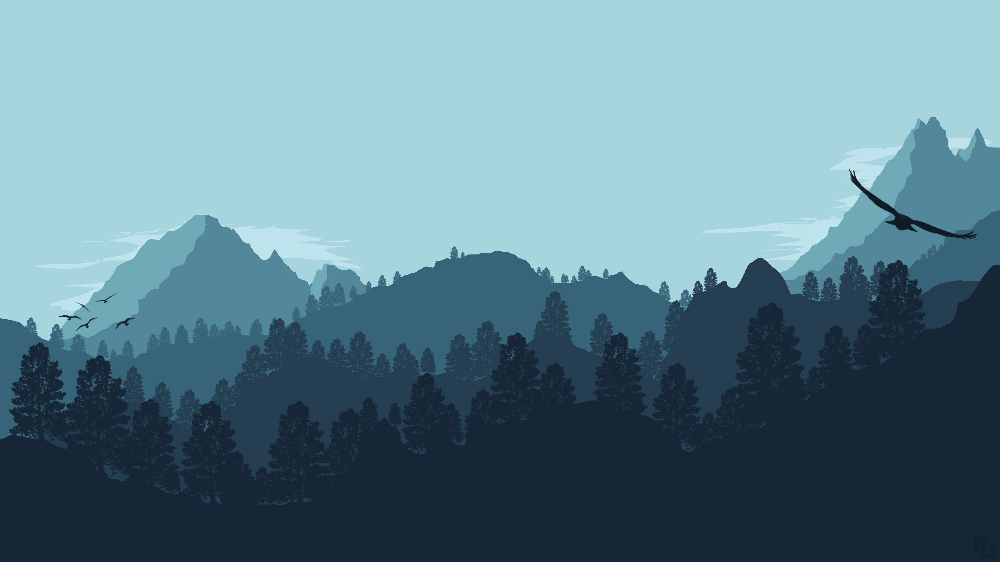
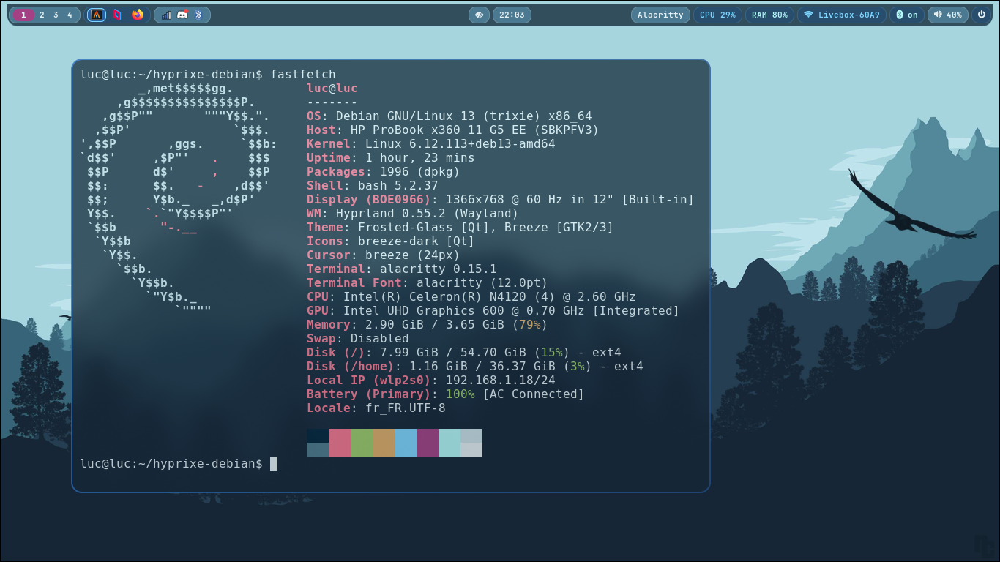

# Hyprixe Debian — Frosted Glass

Debian 13 / Hyprland configuration based on KoolDots, adapted for Alacritty and Dolphin.
The main profile uses the PC's graphics drivers. A separate VMware profile
preserves the software-rendering adjustments needed during earlier testing.

The theme preserves the `min_forest.jpg` wallpaper, translucent blue/cyan glass,
blur, 13 px rounded corners, blue/purple borders, a top Waybar and the
Frosted-Glass Kvantum theme. The original SVG/Kvantum files and wallpaper are
preserved byte for byte. Dolphin retains its original interface and inherited toolbar. A Dolphin-only
Kvantum variant adds blue/cyan translucent paint and matching KDE colors.
<!-- 
-->
## Preview
.

## Quick installation

Target: **Debian 13**, **Hyprland 0.56.2 with Lua configuration** (the working
version reported by the user; API checked against the upstream v0.56.2 tag).
**0.55.2 is the minimum version accepted by the installer**, not a required
version: 0.56.2 is accepted. Future versions require their own compatibility review.
Use a regular user account with `sudo`, an existing Debian SDDM installation
(Qt 6 greeter) and a working GPU driver.

```bash
git clone https://github.com/pixe71/hyprixe-debian.git
cd hyprixe-debian
./install.sh                 # native by default
# or: ./install.sh vmware
```

Log out completely, then select **Hyprland (uwsm-managed)** in SDDM and log in.
The installer installs UWSM from `trixie-backports` and uses Debian's existing
`hyprland-uwsm.desktop` session entry. Installing it does not convert a running
plain Hyprland session; a configuration reload is not enough.

UWSM owns the graphical session lifecycle. Hyprixe starts Waybar and its other
session services after `graphical-session.target`, preserving Debian Waybar's
`Requisite=` dependency. Applications use UWSM scopes, and logout uses `uwsm stop`.
The plain **Hyprland** entry (`start-hyprland`) is not the supported session for
this setup. See [INSTALL.md](INSTALL.md) for session diagnostics.

The installer installs Debian dependencies, enables official backports if needed,
prepares Rofi Wayland 2.0.0 / awww 0.12.1 and a Waybar build with Lua IPC support
if needed, then backs up and deploys user files. The first build may take several
minutes and download C/Rust tools. Read [INSTALL.md](INSTALL.md) for prerequisites,
system changes, backups, restoration and validation steps.

The dedicated **Hyprixe Frosted Glass SDDM theme** extends the same wallpaper,
navy/cyan palette and translucent, blurred panels to the login screen. It includes
the clock/date, account/avatar, password and error feedback, session selector and
power menu. Its Qt 6 QML is written for this project; no downloaded theme is
substituted. Small displays use a scrollable layout and Qt handles HiDPI scaling.
The wallpaper stays a single source asset in the repository.

Installation uses `sudo` for APT and the SDDM theme/configuration files, with
separate system backups. Other themes and session entries are preserved. Reboot
after installing to load the new SDDM configuration; the installer does not restart
SDDM or interrupt your session. Select **Hyprland (uwsm-managed)** in the theme's
session menu. The theme retains SDDM's last selection rather than forcing one.
Qt Virtual Keyboard is disabled with `[General] InputMethod=`; physical keyboard
input and password focus remain normal. The wallpaper request now precedes
Waybar/notifications, without the previous one-second fade. A matching dark base
color covers Hyprland's initial background while the wallpaper layer initializes.
See [SDDM installation and recovery](INSTALL.md#sddm-frosted-glass-login-screen).

Debian's Waybar 0.12 still uses the old IPC for workspace clicks. The installer
reuses a Waybar build with Lua support or builds the same 0.12 base with a limited
adaptation of those requests. The bar's layout and theme stay the same.
See the 0.56.2 compatibility review in `docs/VALIDATION.md`.

```bash
./install.sh --dry-run       # preview, without APT or configuration copying
./install.sh --no-packages   # dependencies already installed, checked before copying
./verify.sh                 # static checks and tests in a temporary HOME
./verify.sh --sddm          # also check the installed login theme and UWSM entry
./verify.sh --session --diagnostics # read-only login journals, timings, clients and layers
./uninstall.sh --list
./uninstall.sh --dry-run
./uninstall.sh              # undo the latest transaction that has not been restored
./uninstall.sh --sddm-only  # restore only the previous login theme, including from a TTY
```

## Components

SDDM with the Hyprixe Qt 6 theme, Hyprland with UWSM and KoolDots Lua modules,
Alacritty, Dolphin, Kvantum/Qt6, Waybar,
Rofi Wayland, Hyprlock, Hypridle, awww, PipeWire/WirePlumber, NetworkManager,
Blueman, SwayNC and cliphist. Icons use Breeze and FontAwesome; the
JetBrains Mono font is available in Debian.

Dolphin keeps its existing layout, icon sizes, panels, view and navigation.
The **Frosted-Glass-Dolphin** Kvantum association changes only Dolphin's paint;
the global Frosted-Glass theme and other Qt applications retain their settings.
Close Dolphin and apply the visual update:

```bash
./install.sh native --dolphin-only
./verify.sh --dolphin
```

If you installed the rejected `9259fa5` layout, restore its saved original
interface first with `--dolphin-only --restore-dolphin-interface`. The installer
selects the matching dated backup and restores only Dolphin interface files;
other desktop changes and new bookmarks are retained. No layout is guessed if
the backup is missing. See [Dolphin appearance and restoration](docs/DOLPHIN.md).

## Keybindings

Workspaces **1–4** are persistent in Hyprland and always shown on Waybar's left
side, without a fixed monitor name. Workspaces 5–10 remain available dynamically.

A compact native `wlr/taskbar` sits beside the workspace buttons: one 16 px icon
per open window, including multiple windows of the same app and other workspaces.
Click to focus that window; its button uses a cyan outline and blue active fill.
Hover shows the window title. The other Waybar modules and keybindings are unchanged.

Default keyboard layout: French AZERTY `fr/latin9`. Workspace bindings use
physical keycodes on the top row, regardless of the AZERTY number symbols.

| Shortcut | Action |
| --- | --- |
| SUPER + Return | Alacritty |
| SUPER + E | Dolphin |
| SUPER + Space | Rofi |
| SUPER + Q | Close the window |
| SUPER + L | Hyprlock |
| SUPER + left / right click | Move / resize |
| SUPER + arrow keys | Move focus |
| SUPER + SHIFT + arrow keys | Move the window |
| SUPER + CTRL + arrow keys | Resize in 50 px steps |
| SUPER + keys 1–0, physical positions | Workspaces 1–10 |
| SUPER + SHIFT + keys 1–0 | Send the window to a workspace |
| SUPER + PageUp / PageDown or scroll wheel | Previous / next workspace |
| SUPER + F / SHIFT + F | Fullscreen / maximize |
| SUPER + V | Floating |
| SUPER + P / J | Pseudo / toggle dwindle split |
| ALT + Tab / ALT + SHIFT + Tab | Next / previous window on the current workspace |
| ALT + F10 | Rofi switcher for all windows |
| SUPER + CTRL + V | Clipboard history |
| SUPER + SHIFT + S | Select an area and copy its PNG to the clipboard |
| Print | Save a full-desktop PNG in `~/Pictures/Screenshots/` |
| SHIFT + Print | Select an area and save its PNG in `~/Pictures/Screenshots/` |
| SUPER + Print / SUPER + SHIFT + Print | Existing full-screen / area capture: save and copy |
| SUPER + SHIFT + E | Session/power menu |

Media and brightness keys are preserved. A horizontal three-finger gesture
switches workspaces. There is a single source of active keybindings:
`.config/hypr/lua/keybinds.lua`. Personal additions are loaded afterwards from
`UserConfigs/user_keybinds.lua`; no file in `extras/` overrides them.

`./verify.sh --session` audits the 67 bindings actually registered in Hyprland,
their enabled Lua handles, modifiers, physical workspace codes, conflicts,
installed scripts and command dependencies. See the [keyboard/mouse audit](docs/KEYBINDS.md)
for API evidence, limitations and the physical-PC test procedure. A registry
check does not simulate a key press or prove the resulting focus change.

Saved screenshots use timestamped names such as
`Screenshot-2026-10-26_21-30-15-a1B2c3.png`. The unique suffix prevents overwrites
even for captures taken simultaneously. Cancelling a selection leaves the
clipboard and screenshot directory untouched. See [INSTALL.md](INSTALL.md#screenshots).

## Profiles and layout

```text
.config/                  active configuration, native by default
.local/share/kxmlgui5/     Dolphin toolbar (path also used by KF6)
wallpapers/               single Frosted Glass image
sddm/themes/hyprixe-frosted/ original Qt 6 login theme; wallpaper copied at install time
profiles/native/          no forced graphics settings
profiles/vmware/          explicit software rendering, optional monitor examples
extras/kooldots/          optional upstream library, never installed
scripts/                  deployment, dependencies, validation
tests/                    isolated tests; no mock session presented as a real one
docs/                     audit, original inventory and validation results
install.sh / uninstall.sh / verify.sh
packages*.txt
```

The profiles share the theme, SUPER keybindings and monitor detection.
The VMware profile adds Mesa software-rendering variables and a software cursor.
It does not force a resolution; the `Virtual-1` examples are not installed.
Switching profiles requires logging out and back in to refresh the application
environment.

## Credits

- [KoolDots / LinuxBeginnings](https://github.com/LinuxBeginnings/Hyprland-Dots),
  based on [JaKooLit's dotfiles](https://github.com/JaKooLit/Hyprland-Dots):
  Lua base, scripts, animations and configuration library. The
  GPL-3.0-or-later headers are preserved.
- Senshi: Frosted Glass/Dolphin inspiration and files, as identified by the
  original repository and its author. The original repository does not include
  an exact source URL or wallpaper license; see [CREDITS.md](CREDITS.md).
- [adi1090x/rofi](https://github.com/adi1090x/rofi): Rofi layout, inherited through KoolDots.
- [Kvantum / Tsu Jan](https://github.com/tsujan/Kvantum), KvAdapta and Vince/Liuice:
  authors credited in the supplied Kvantum theme.
- [Hyprland](https://github.com/hyprwm/Hyprland), [Waybar](https://github.com/Alexays/Waybar),
  [UWSM](https://github.com/Vladimir-csp/uwsm),
  [SDDM](https://github.com/sddm/sddm) and [Qt Quick](https://doc.qt.io/qt-6/qtquick-index.html),
  [Rofi](https://github.com/davatorium/rofi), [awww](https://codeberg.org/LGFae/awww),
  [Alacritty](https://github.com/alacritty/alacritty), [Dolphin](https://invent.kde.org/system/dolphin).

This project adapts and integrates those works. References and provenance
limitations are documented in [CREDITS.md](CREDITS.md) and
[docs/AUDIT.md](docs/AUDIT.md).
