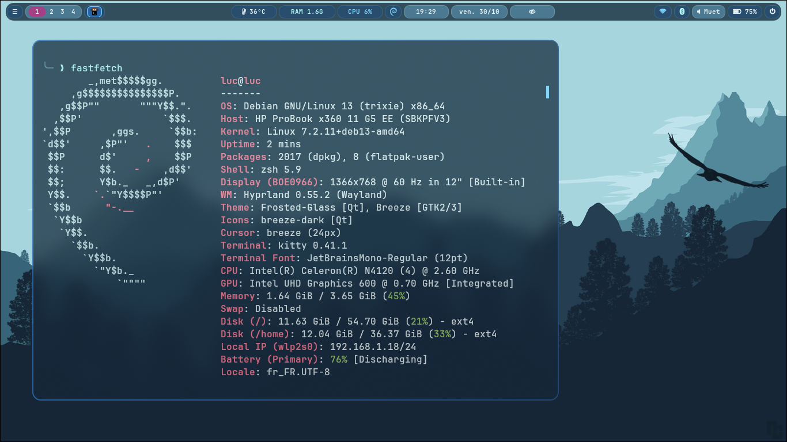
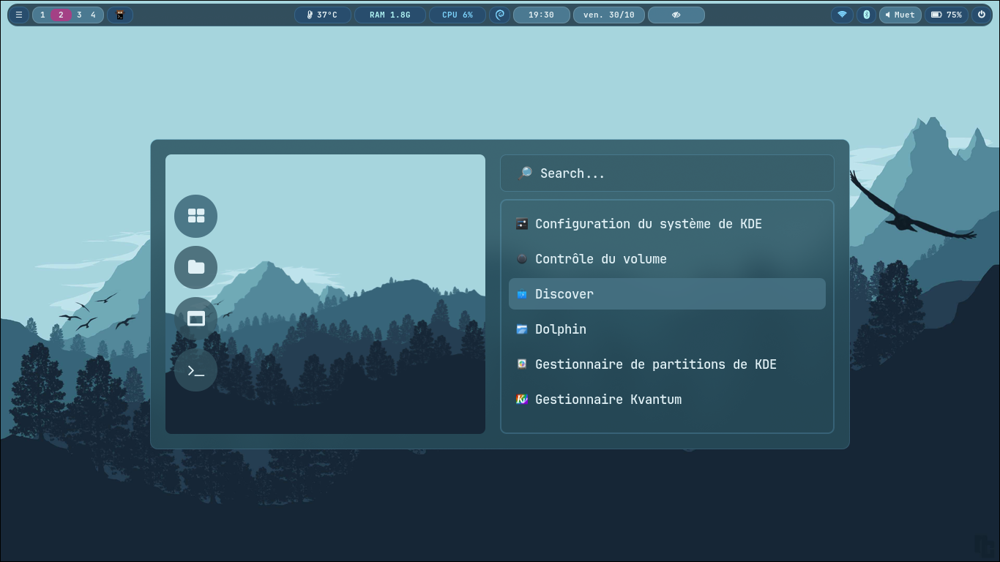
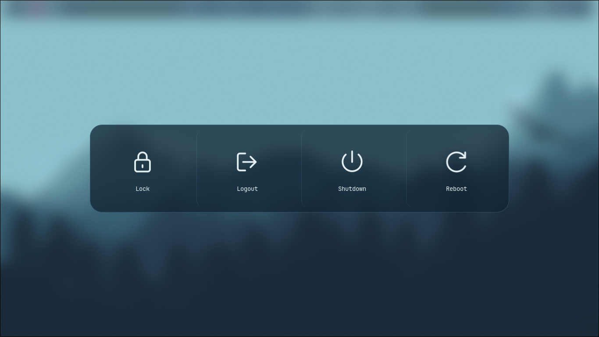

# Hyprixe

A complete Hyprland desktop configuration for **Debian 13 Trixie**, built on
KoolDots and a Frosted Glass theme. UWSM manages the session; installation,
dated backups, restoration and verification are included.

## Preview

| Application launcher | Session menu |
| --- | --- |
|  |  |
 |

## Overview

Hyprixe combines a translucent blue/grey desktop, cyan accents, compositor blur
and rounded surfaces. Waybar, Rofi, Wlogout, Kitty, Dolphin and SDDM share that
visual direction. Dolphin uses a lighter neutral glass variant.

Native hardware is the default target. VMware compatibility is isolated in an
optional profile rather than required by the native configuration.

## Features

- UWSM-managed Hyprland with four persistent workspaces and audited Lua bindings.
- Top Waybar with a collapsible tray, application icons and adaptive CPU-temperature/root-storage reporting.
- Rofi applications and window menus with wallpaper/sidebar; compact clipboard history.
- Four-action Wlogout menu: Lock, Logout, Shutdown and Reboot, with confirmations.
- Kitty with Zsh, pinned upstream Powerlevel10k, autosuggestions and syntax highlighting.
- Dolphin with Kvantum glass paint, Hyprlock/Hypridle, SwayNC notifications and managed wallpaper startup.
- Screenshots, file-level deployment backups and source/dependency/live-session checks.

## Components

| Role | Component |
| --- | --- |
| Compositor / session | Hyprland Lua, UWSM, systemd user services |
| Bar / menus | Waybar, Rofi Wayland, Wlogout |
| Terminal / interactive shell | Kitty, Zsh, Powerlevel10k |
| File manager / Qt style | Dolphin, Qt6 Kvantum |
| Login / lock / idle | SDDM Hyprixe Frosted, Hyprlock, Hypridle |
| Notifications / wallpaper | SwayNC, awww |
| Clipboard / screenshots | cliphist, wl-clipboard, grim, slurp |
| Installation / validation | Bash entrypoints, Python helpers and isolated tests |

Hyprixe scripts remain **Bash**, regardless of the interactive shell.

## Requirements

Debian 13 Trixie, a normal sudo-enabled user, Git/Python 3 and **SDDM with its
Qt 6 greeter already installed** are required. A first install needs network
access and may build compatible Waybar/Rofi/awww binaries.

The configuration minimum is **Hyprland 0.55.2**. Reference release numbers are
**0.55.2 and 0.56.2**; newer/unreviewed builds remain provisional and must pass
the same capability checks. See the [version policy](docs/hyprland-compatibility.md).
See [requirements](docs/requirements.md) for package sources, architecture
limits and optional validation tools.

## Installation

```bash
git clone https://github.com/pixe71/hyprixe-debian.git
cd hyprixe-debian
./install.sh native
```

Run as your desktop user, not root,
sudo is used where necessary. Existing managed files are backed up before
replacement. The installer also configures SDDM and changes the invoking
account's login shell to validated Zsh as its final step.

`native` is the default; `vmware`, `--dry-run`, `--no-packages` and scoped
component modes are documented in [installation](docs/installation.md).
`--no-packages` requires previously prepared dependencies and assets.

## First login

Save your work and reboot after the initial installation. In SDDM select
**Hyprland (uwsm-managed)**. UWSM owns the graphical-session target and
environment required by Waybar, notifications and the wallpaper services.
Follow the [first-login checks](docs/first-start.md).

## Main keybindings

| Shortcut | Action |
| --- | --- |
| `SUPER + Return` | Kitty |
| `SUPER + Space` | Rofi application launcher |
| `SUPER + E` | Dolphin |
| `SUPER + Q` | Close focused window |
| `SUPER + L` | Hyprlock |
| `SUPER + Backspace` / `SUPER + SHIFT + E` | Same Wlogout menu |
| `SUPER + CTRL + V` | Clipboard history |
| `ALT + Tab` / `ALT + SHIFT + Tab` | Next/previous window on current workspace |
| `ALT + F10` | Graphical window switcher |
| `SUPER + V` / `SUPER + F` | Floating / fullscreen |
| `SUPER + left/right click` | Move / resize window |
| `SUPER + arrows` | Focus window |
| `SUPER + 1..4` / `SUPER + SHIFT + 1..4` | Focus workspace / move window there |
| `SUPER + SHIFT + S` | Area screenshot to clipboard |
| `Print` / `SHIFT + Print` | Save full / area screenshot |

Workspace digits refer to physical number-row positions, including on the
default French AZERTY layout. The [complete reference](docs/keybindings.md)
covers all 68 bindings, workspaces 1–10, media keys and the touchpad gesture.

## Verification

```bash
./verify.sh                              # repository and isolated tests
./verify.sh --dependencies               # also require installed runtime
./verify.sh --dependencies --session     # inside the active Hyprixe session
```

Successful runs end with `RESULT: 0 failed check(s)`. Optional unavailable tools
and interactive checks can be `SKIPPED`; they are not claims of success.
See [verification](docs/verification.md) and [troubleshooting](docs/troubleshooting.md).

## Documentation

The [documentation index](docs/README.md) links installation, components,
customization, architecture and recovery. `docs/` is the canonical source;
[short Wiki pages](docs/wiki/Home.md) link back to it.

## Updating

```bash
git pull --ff-only
# Close Dolphin before the full deployment.
./install.sh native
```

Reconnect when session, environment or shell settings change; reboot when the
greeter needs refreshing. Then run `./verify.sh --dependencies --session`.
[Updating](docs/update.md) explains scoped updates and when reload is sufficient.

## Uninstall / restore

```bash
./uninstall.sh --list
./uninstall.sh --backup=BACKUP_ID --dry-run
./uninstall.sh --backup=BACKUP_ID
```

Restore uses dated transactions and refuses conflicting later edits. Linked
SDDM and login-shell state are covered where recorded; Debian packages are
retained. Read [restore](docs/uninstall-restore.md) before selecting a backup.

## Status

The Debian v1 documentation is being reviewed before tagging. Automated checks
do not replace physical keyboard/mouse, PAM, GPU blur and login-transition
testing. Asset provenance and the remaining release checklist are tracked in
[release readiness](docs/release-readiness.md). A NixOS port is a future plan,
not an installation option for this version.

## License

Hyprixe's integrated configuration and maintenance work use
[GPL-3.0-or-later](LICENSE), subject to third-party asset licenses. Credits
include KoolDots/LinuxBeginnings, JaKooLit, Senshi, KDE, Kvantum, Waybar, UWSM,
Rofi, Wlogout, Powerlevel10k and font authors. See [credits and provenance](CREDITS.md),
including confirmed Senshi/Graphite sources and unresolved wallpaper rights.
